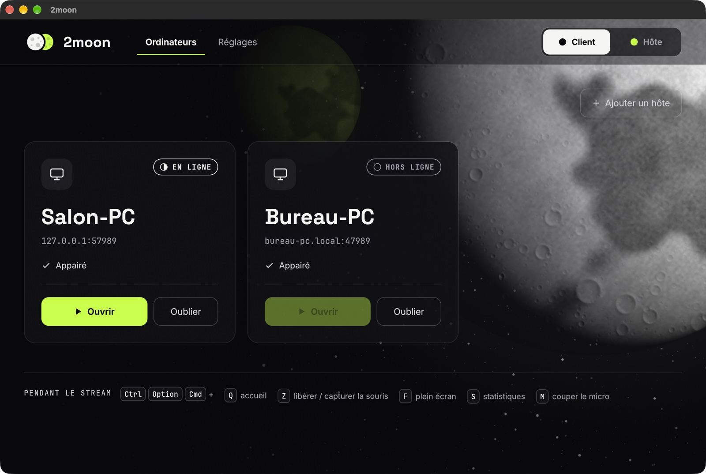
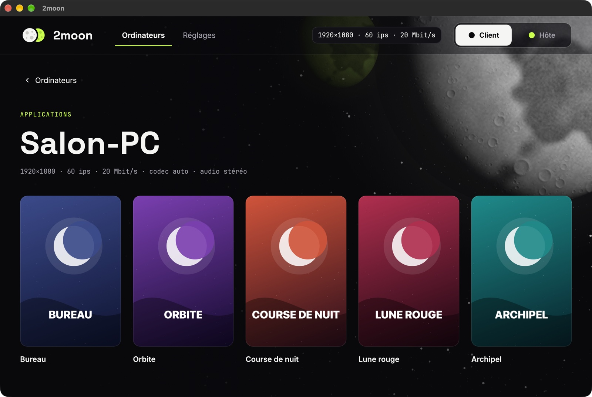
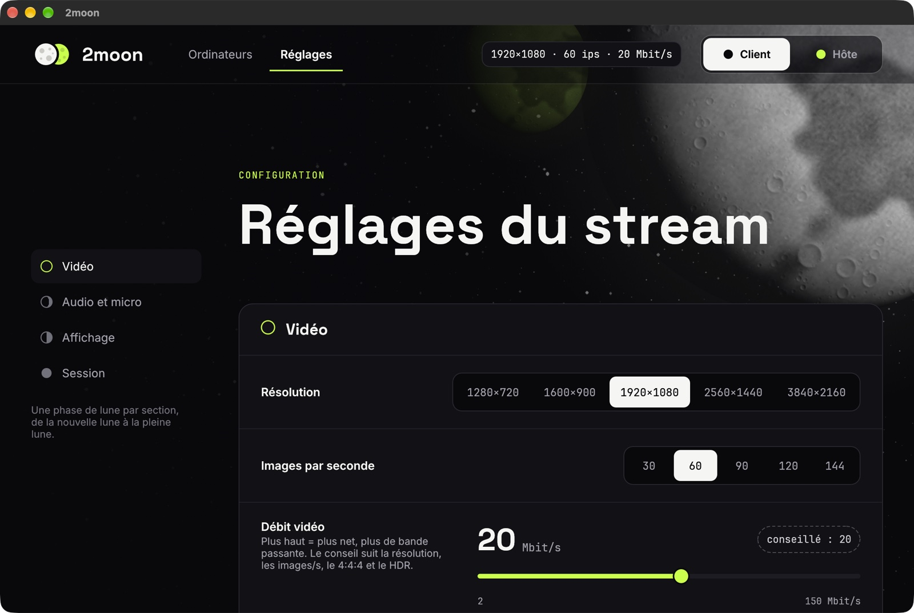
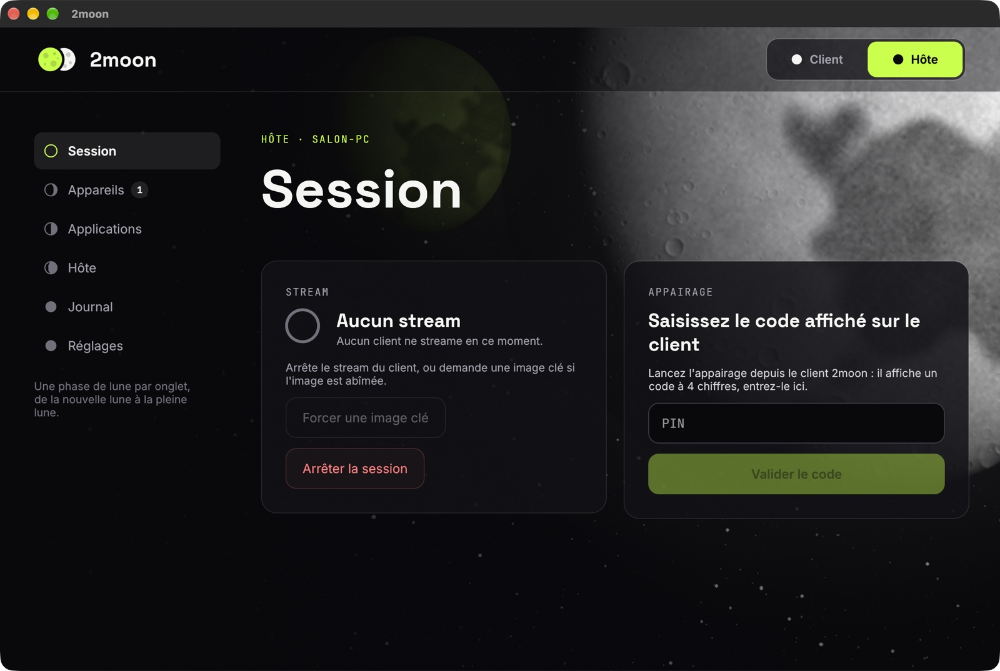
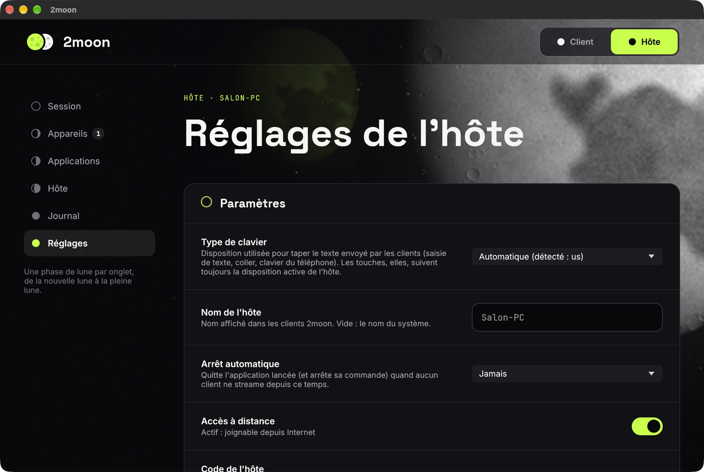

<p align="center">
  
</p>

<h1 align="center">2moon</h1>

<p align="center">
  <strong>Jouez à vos jeux PC depuis n'importe quel écran, chez vous ou à l'autre bout du monde.</strong><br>
  Hôte et client de streaming de jeu, en un seul logiciel libre, écrit en Rust.
</p>

<p align="center">
  <a href="https://github.com/RM4Y/2moon/releases/latest"></a>
  
  <a href="LICENSE"></a>
</p>

<p align="center">
  
</p>

---

## Pourquoi 2moon ?

- **Un seul logiciel, deux rôles.** La même application sert de **client** (pour jouer)
  et d'**hôte** (l'ordinateur qui fait tourner les jeux). Un bouton les sépare.
- **Aucun port à ouvrir.** Hors de chez vous, saisissez le **code de l'hôte** : la
  connexion traverse la box et le NAT toute seule, chiffrée de bout en bout.
- **Faible latence.** Encodage matériel, paquets envoyés dès qu'une image est prête,
  décodage GPU et affichage sans copie.
- **Belle image.** H.264, HEVC et AV1, jusqu'en 4K, à 144 images/s, avec la HDR 10 bits
  et les couleurs 4:4:4 pour un texte net.
- **Pensé pour tout le monde.** Installateurs pour Windows, macOS et Linux, appairage
  en un code PIN, réglages clairs, interface « nuit lunaire ».

## Aperçu

<table>
  <tr>
    <td width="50%"><br><sub><b>Applications</b> : lancez un jeu ou le bureau de l'hôte en un clic.</sub></td>
    <td width="50%"><br><sub><b>Réglages du stream</b> : résolution, images/s, débit conseillé, codec, HDR, micro.</sub></td>
  </tr>
  <tr>
    <td width="50%"><br><sub><b>Mode Hôte</b> : suivez la session en direct et autorisez un nouvel appareil.</sub></td>
    <td width="50%"><br><sub><b>Réglages de l'hôte</b> : nom, clavier, arrêt automatique, accès à distance.</sub></td>
  </tr>
</table>

## Fonctionnalités

| | |
|---|---|
| 🎮 **Jeu** | Clavier, souris (mode relatif pour les jeux), jusqu'à 4 manettes avec vibrations (PlayStation, Xbox, Switch Pro, Steam) |
| 🖥️ **Vidéo** | H.264 · HEVC · AV1, jusqu'en 3840×2160 et 144 images/s, HDR 10 bits, couleurs 4:4:4 |
| ⚡ **Latence** | Encodage NVENC / AMF / Quick Sync / VAAPI / VideoToolbox, décodage GPU, copie zéro, récupération des pertes sans image clé (RFI) |
| 🔊 **Son** | Stéréo, 5.1 et 7.1 chiffrés ; **micro du client** envoyé à l'hôte (chat vocal) |
| 🌍 **À distance** | Connexion par code, sans ouvrir de port : directe à travers le NAT, relais en dernier recours |
| 🔒 **Sécurité** | Appairage par PIN, certificats épinglés, flux chiffrés (AES), panneau d'administration protégé |
| 🪄 **Confort** | Résolution de l'écran de l'hôte adaptée au client, arrêt automatique, raccourcis système envoyés à l'hôte, texte collé |
| 🧭 **Administration** | Mode Hôte dans l'application et panneau web : session en direct, appareils, applications et jaquettes, journal |

## Télécharger

Rendez-vous sur la **[dernière version](https://github.com/RM4Y/2moon/releases/latest)** :

| Système | Fichier | Installation |
|---|---|---|
| **Windows 10 / 11** (64 bits) | `2moon-…-windows-x86_64-setup.exe` | Lancez l'installateur : application, hôte en service et manettes virtuelles |
| **macOS** (Apple Silicon) | `2moon-…-macos-arm64.dmg` | Glissez **2moon** dans Applications ; la 1ʳᵉ fois : clic droit › **Ouvrir** |
| **Debian, Ubuntu** | `2moon_…_amd64.deb` | `sudo apt install ./2moon_…_amd64.deb` |
| **Fedora, openSUSE** | `2moon-….x86_64.rpm` | `sudo dnf install ./2moon-….x86_64.rpm` |
| **Arch, Manjaro** | `2moon-…-x86_64.pkg.tar.zst` | `sudo pacman -U 2moon-…-x86_64.pkg.tar.zst` |
| **Autre Linux** | `2moon-…-linux-x86_64.tar.gz` | Extrayez puis `./install.sh` (sans droits root) |

FFmpeg, Opus et SDL3 sont fournis : rien d'autre à installer.

## Démarrage rapide

1. **Sur l'ordinateur de jeu**, ouvrez 2moon et passez en mode **Hôte** (en haut à droite).
   L'hôte s'installe comme service et tourne même application fermée.
2. **Sur l'appareil qui joue**, ouvrez 2moon en mode **Client** : l'hôte apparaît tout
   seul s'il est sur le même réseau.
3. **Appairez** : cliquez sur l'hôte, un code à 4 chiffres s'affiche. Saisissez-le sur
   l'hôte (onglet **Session** du mode Hôte).
4. **Jouez** : choisissez une application. **Ctrl+Alt+Maj+Q** (⌃⌥⌘Q sur Mac) revient à l'accueil.

### Jouer hors de chez vous

Un appareil appairé à la maison retrouve son hôte **tout seul** depuis n'importe où.
Pour un nouvel appareil, copiez le **code de l'hôte** (mode Hôte › Réglages ›
Code de l'hôte) et collez-le dans **Ajouter un hôte** : l'appairage demande toujours
le PIN saisi sur l'hôte. Un code divulgué se change en un clic, l'ancien cesse
aussitôt de fonctionner.

### Raccourcis pendant le stream

| Ctrl+Alt+Maj (⌃⌥⌘ sur Mac) + | |
|---|---|
| **Q** | revenir à l'accueil |
| **Z** | libérer / capturer la souris |
| **F** | plein écran |
| **S** | statistiques (latence, débit, pertes) |
| **M** | couper le micro |

## Compatibilité

| | Windows | macOS | Linux |
|---|---|---|---|
| **Client** | ✅ décodage NVDEC, D3D11VA | ✅ VideoToolbox | ✅ NVDEC, VAAPI |
| **Hôte** | ✅ NVENC, AMF, Quick Sync · service, écran de connexion et UAC | ✅ VideoToolbox · ScreenCaptureKit | ✅ NVENC, VAAPI · KDE, GNOME, wlroots |
| **Manettes côté hôte** | ✅ ViGEmBus | — | ✅ uinput |
| **Micro du client** | client ✅ | client ✅ | client et hôte ✅ |

Sans GPU compatible, l'encodage et le décodage passent par le processeur (H.264).

## Compiler depuis les sources

```sh
cargo build --release
# target/release/moon-client (application) et target/release/moon-server (hôte)
```

Aucun en-tête de développement n'est requis : FFmpeg, CUDA, PipeWire, PulseAudio, Opus
et SDL3 sont chargés à l'exécution. Les paquets se construisent avec
`scripts/package-release.sh <version>`.

Tout le détail (options de l'hôte, ligne de commande, architecture, fonctionnement de
l'accès à distance, HDR, tests) est dans le **[guide détaillé](docs/GUIDE.md)**.

## Architecture

```
crates/
  moon-proto    protocole pur : appairage, RTSP, vidéo + FEC, audio, contrôle
  moon-media    codecs : NVENC, NVDEC, FFmpeg, VAAPI, Opus, conversions YUV
  moon-server   hôte : capture, encodage, entrées virtuelles, panneau web
  moon-client   application : client, mode Hôte, interface egui
  moon-tunnel   accès à distance (QUIC, traversée du NAT, relais)
```

## Licence

2moon est un logiciel libre sous licence **[GPL-3.0](LICENSE)**.
